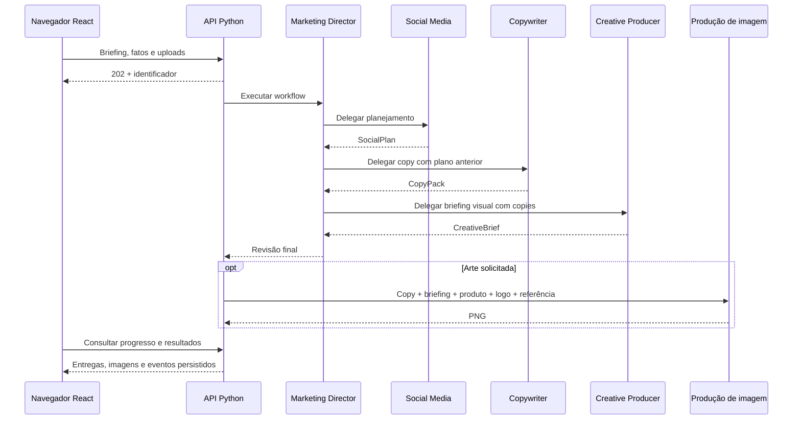

# Real Center Studio: arquitetura do mini app

## Estrutura da workspace

```text
create-rc-agents/
├── front-end/                         React + Tailwind + Vite
│   ├── src/components/                formulário, uploads, agentes e resultados
│   ├── src/api.js
│   └── package-lock.json
└── realcenter-marketing-ai/
    ├── src/realcenter_marketing/
    │   ├── web/
    │   │   ├── server.py              rotas HTTP e arquivos do frontend
    │   │   ├── service.py             tarefas em segundo plano; uma por vez
    │   │   ├── storage.py             histórico e catálogo local
    │   │   ├── uploads.py             validação das imagens recebidas
    │   │   ├── images.py              produção da arte pela API OpenAI
    │   │   └── static/                build gerado pelo Vite
    │   ├── agents.py                  Director e três especialistas
    │   ├── workflow.py                execução e validação da campanha
    │   └── progress.py                entregas parciais e eventos
    ├── brand/
    └── campaigns/runs/run-<id>/        dados persistidos de cada execução
```

O frontend tem sua própria pasta e lockfile. Hoje ele é uma pasta irmã do repositório Python; versioná-lo junto exige adotar um repositório na raiz da workspace ou publicar um repositório próprio. Nenhum repositório remoto foi criado.

## Fluxo



O Director continua sendo o orquestrador dos agentes; o serviço web gerencia o ciclo de execução. A produção da imagem é uma etapa posterior que consome as entregas reais. Os agentes de texto não interpretam pixels: as fotos são enviadas ao modelo de imagem. Informe produto, preço e condições no briefing. A arte gerada exige revisão visual, principalmente rótulos, logo e textos.

## Rotas locais

- `GET /api/config`: estado da configuração e token local; nunca retorna a API key.
- `GET /api/runs`: histórico das últimas 50 execuções e tarefa ativa.
- `POST /api/runs`: iniciar campanha; corpo validado por Pydantic.
- `POST /api/runs/<id>/image`: produzir outra arte usando a campanha completa e suas referências, sem executar os agentes novamente.
- `GET /api/media`: catálogo de fotos e artes locais.
- `GET /media/<id>`: imagem identificada pelo catálogo, sem aceitar caminhos arbitrários.
- `GET /api/runs/<id>/files/<nome>`: downloads dos arquivos permitidos.

Cada execução persiste briefing, produto/referência, entregas JSON, legenda TXT, eventos e PNGs. O prompt de imagem é preservado. Uma falha da imagem não apaga a campanha textual. Recomeçar uma campanha cria outra pasta. Não há retomada automática de uma etapa textual nem fila persistente. Se o servidor for fechado durante o trabalho, a execução poderá ficar parcial; não será reiniciada silenciosamente.

## Limites e execução local

Uma tarefa por vez limita uso de memória e chamadas concorrentes. O frontend consulta eventos a cada 2 segundos e só carrega imagens exibidas. O app não precisa de Node em execução após o build. O modo demonstração exercita o SDK com respostas fixas e não produz imagem.

O servidor escuta apenas em localhost, valida Host/Origin e exige token em operações de escrita. Uploads são limitados e validados. Não há login nem isolamento multiusuário. Este servidor é destinado ao computador local; para publicar, adicione autenticação, HTTPS e um servidor de aplicação apropriado.

## Docker e MCP

Nenhum dos dois é necessário nesta fase. Docker pode ser adicionado para distribuição ou hospedagem reproduzível, com build React e runtime Python, persistindo `campaigns/` e mantendo a chave apenas no backend. Não foi instalado nem criado serviço Docker.

MCP é uma interface de ferramentas/contexto para clientes compatíveis, não um requisito para coordenar agentes. Se futuramente outro sistema precisar chamar o Real Center Studio, uma camada MCP pode expor funções do `CampaignService`, mantendo o Director e as políticas atuais. Não há servidor MCP nem novas permissões SGCloud nesta entrega.

## Verificação

Testes cobrem orquestração existente, uploads, autenticação local das mutações, downloads, bloqueio de concorrência, preservação de resultados e o adaptador de imagem com cliente simulado. A validação de UI usa demonstração sem API. A disponibilidade dos modelos foi consultada na conta; isso não garante crédito ou sucesso de geração. A geração real de imagem pela nova interface ainda precisa de validação com a API.

Referências técnicas: [Images API](https://developers.openai.com/api/docs/guides/image-generation), [Tailwind com Vite](https://tailwindcss.com/docs/installation/using-vite).

## Ações de campanha

Campanhas interrompidas oferecem Tentar novamente e Excluir. Se a campanha textual já está salva, a tentativa refaz somente a imagem; caso contrário, cria outra execução com o mesmo briefing e uploads. Campanhas concluídas oferecem Editar e Excluir. Editar preenche o formulário e gera uma nova versão, preservando a original. Excluir requer confirmação no app e move a pasta validada para campaigns/runs/.trash, retirando-a do histórico e da biblioteca. Nenhuma exclusão é permitida durante trabalho ativo.

As ações usam POST /api/runs/<id>/retry e /delete, protegidos pelo mesmo token local. GET /api/runs/<id>/draft recupera briefing, opções e referências para edição. A interface adota tema escuro em todos os estados. Verificação: 25 testes Python e testes de edição/exclusão no navegador, sem consumir créditos da API.
